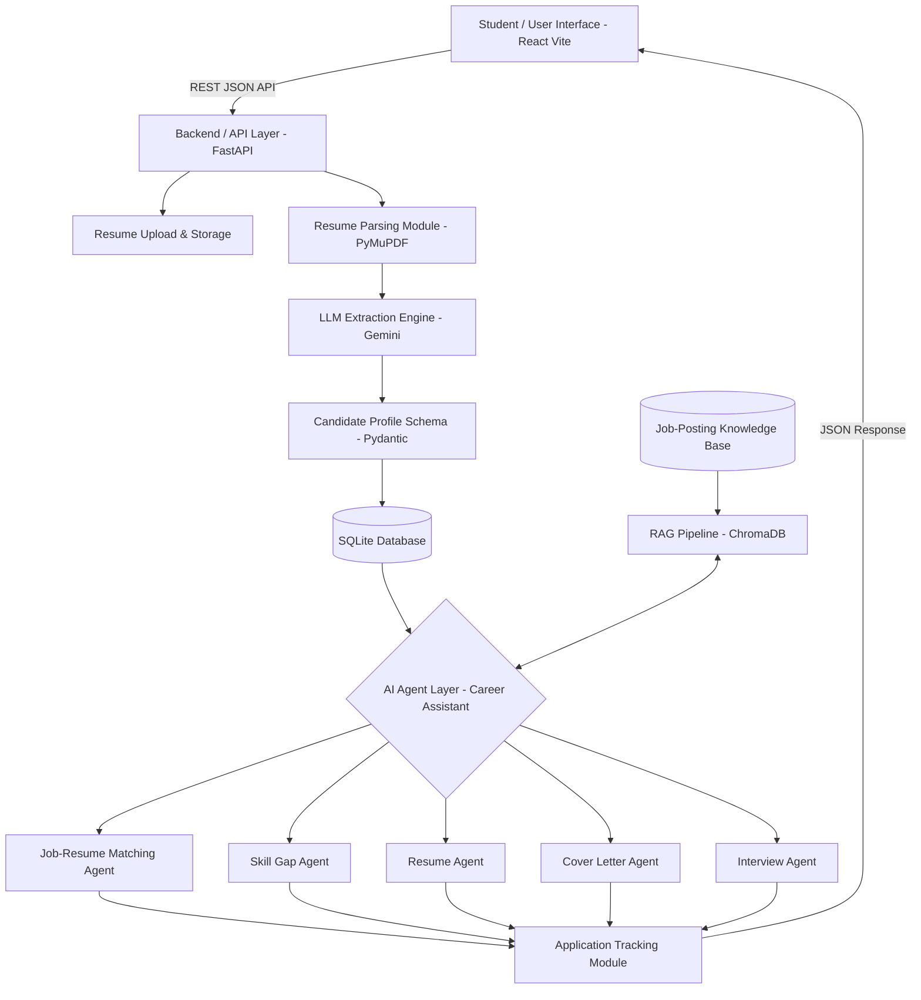

# AI Career Companion Agent for Internship Matching and Interview Preparation

An end-to-end full-stack multi-agent AI system designed to help students build structured candidate profiles from raw resumes, match with relevant internships via RAG, identify skill gaps, tailor application materials, and practice role-specific interviews.

---

## System Architecture



---

## Data Flow (Milestone 1 Pipeline)
1. **Student Onboarding (React UI):** Student enters basic details (Name, Email, Preferred Role, Preferred Location) and uploads a PDF resume via a clean React form.
2. **REST API Ingestion (FastAPI):** React sends the form data and PDF file (`multipart/form-data`) to the FastAPI backend endpoint (`POST /api/profiles/upload`).
3. **Resume Storage & Text Extraction:** FastAPI saves the uploaded PDF locally and uses `PyMuPDF` to extract raw text across all pages.
4. **LLM Structured Parsing:** The raw text is passed to the Gemini LLM with a strict Pydantic schema (`CandidateProfile`), extracting structured fields (`technical_skills`, `education`, `experience`, `projects`, `certifications`, `target_roles`).
5. **Database Persistence & UI Display:** SQLite stores the metadata, raw text, and validated JSON profile, returning the structured profile to React for clean card-and-badge rendering.

---

## Multi-Agent Responsibilities
* **Career Assistant (Supervisor):** Central coordinator that manages student state and routes requests to specialized worker agents.
* **Job-Resume Matching Agent:** Queries the RAG job knowledge base using the candidate's structured profile and ranks internships by relevance.
* **Skill Gap Agent:** Compares the candidate's current skills against target job requirements and highlights missing competencies.
* **Resume Agent:** Rewrites and tailors resume project descriptions and bullet points for specific internship roles.
* **Cover Letter Agent:** Generates customized cover letters grounded in the candidate's verified projects and target company details.
* **Interview Agent:** Generates role-specific technical and behavioral interview questions based on the candidate's resume and skill gaps.

---

## Tech Stack

| Component | Technology | Purpose |
| :--- | :--- | :--- |
| **Frontend UI** | React (Vite) + Tailwind CSS | Modern component-based web interface for profile creation and parsed profile viewing |
| **Backend / API Layer** | FastAPI + Uvicorn | Asynchronous Python REST API connecting the React UI, parser, LLM, and database |
| **Schema Validation** | Pydantic | Enforces strict JSON structure on API payloads and LLM-extracted candidate data |
| **PDF Text Parser** | PyMuPDF (`fitz`) | Extracts clean text from PDF resumes |
| **LLM Engine** | Gemini API (`google-genai`) | Structured extraction of skills, education, projects, and experience |
| **Relational Database** | SQLite | Stores student metadata, resume file paths, raw text, and JSON profiles |
| **Vector DB & RAG** *(M2)* | ChromaDB + Embeddings | Semantic retrieval over internship job descriptions |
| **Agent Orchestration** *(M2)* | LangGraph | Multi-agent state management and routing |

---

## Repository Structure

```text
├── backend/
│   ├── requirements.txt        # Python backend dependencies
│   └── app/
│       ├── __init__.py
│       ├── main.py             # FastAPI routes & CORS configuration
│       ├── schemas.py          # M1.2 CandidateProfile Pydantic models
│       ├── database.py         # M1.3 SQLite database operations
│       ├── parser.py           # M1.4 PDF text extraction module
│       └── extractor.py        # M1.4 LLM structured extraction module
├── frontend/
│   ├── package.json            # React + Vite dependencies
│   ├── index.html
│   └── src/
│       ├── App.jsx             # Main layout & navigation
│       └── components/
│           ├── ProfileForm.jsx # Student onboarding & resume upload form
│           └── ProfileView.jsx # Structured candidate profile cards & badges
├── docs/
│   └── M1_Research_Notes.md    # M1.1 research on workflows, RAG, and agent patterns
└── README.md                   # System architecture and project overview
```
