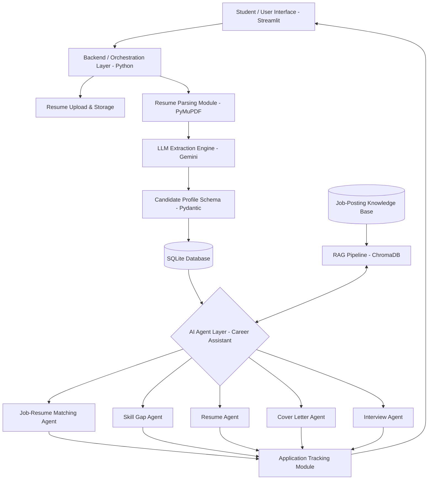

# AI Career Companion Agent for Internship Matching and Interview Preparation

An end-to-end multi-agent AI system designed to help students build structured candidate profiles from raw resumes, match with relevant internships via RAG, identify skill gaps, tailor application materials, and practice role-specific interviews.

---

## System Architecture



---

## Data Flow (Milestone 1 Pipeline)
1. **Student Onboarding (UI):** Student enters basic details (Name, Email, Preferred Role, Preferred Location) and uploads a PDF resume via Streamlit.
2. **Resume Storage:** The uploaded PDF is saved in the local resume directory and its file metadata is logged.
3. **Text Extraction:** `PyMuPDF` extracts raw plain text across all pages of the PDF.
4. **LLM Structured Parsing:** The raw text is passed to the Gemini LLM with a strict Pydantic schema (`CandidateProfile`), extracting structured fields (`technical_skills`, `education`, `experience`, `projects`, `certifications`, `target_roles`).
5. **Database Persistence:** Both the raw resume text and validated JSON profile are stored in SQLite for downstream retrieval by the AI agents.

---

## Multi-Agent Responsibilities
* **Career Assistant (Supervisor):** Central coordinator that manages student state and routes requests to specialized worker agents.
* **Job-Resume Matching Agent:** Queries the RAG job knowledge base using the candidate's structured profile and ranks internships by relevance.
* **Skill Gap Agent:** Compares the candidate's current skills against target job requirements and highlights missing competencies.
* **Resume Agent:** Rewrites and tailors resume project descriptions and bullet points for specific internship roles.
* **Cover Letter Agent:** Generates customized cover letters grounded in the candidate's verified projects and target company details.
* **Interview Agent:** Generates role-specific technical and behavioral interview questions based on the candidate's resume and skill gaps.

---

## Tech Stack

| Component | Technology | Purpose |
| :--- | :--- | :--- |
| **User Interface** | Streamlit | Interactive web UI for profile creation, PDF upload, and profile inspection |
| **Backend Language** | Python 3.11 | Core application logic and pipeline orchestration |
| **Schema Validation** | Pydantic | Enforces strict JSON structure on LLM-extracted candidate data |
| **PDF Text Parser** | PyMuPDF (`fitz`) | Extracts clean text from PDF resumes |
| **LLM Engine** | Gemini API (`gemini-2.5-flash`) | Structured extraction of skills, education, projects, and experience |
| **Relational Database** | SQLite | Stores student metadata, resume file paths, raw text, and JSON profiles |
| **Vector DB & RAG** *(M2)* | ChromaDB + Embeddings | Semantic retrieval over internship job descriptions |
| **Agent Orchestration** *(M2)* | LangGraph | Multi-agent state management and routing |

---

## Repository Structure

```text
├── app.py                      # Streamlit frontend application
├── requirements.txt            # Python dependencies
├── README.md                   # System architecture and project overview
├── docs/
│   └── M1_Research_Notes.md    # M1.1 research on workflows, RAG, and agent patterns
└── src/
    ├── __init__.py
    ├── schemas.py              # M1.2 CandidateProfile Pydantic models
    ├── database.py             # M1.3 SQLite database operations
    ├── parser.py               # M1.4 PDF text extraction module
    └── extractor.py            # M1.4 LLM structured extraction module
```
